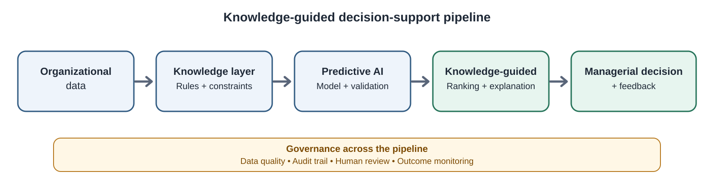
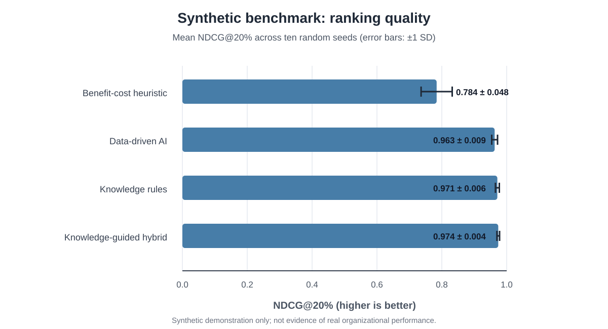

# A Knowledge-Guided AI Decision System for Data-Driven Digital Transformation and Organizational Performance Optimization

**Article type:** Short communication

**Author:** Akshara Ramagiri  
**Affiliation:** Midwest University  
**Corresponding author:** Akshara Ramagiri; email: akshara.ramagiri@midwest.edu

## Abstract

Digital transformation requires organizations to prioritize initiatives under constraints involving strategic fit, data readiness, capability, expected benefit, investment, and implementation risk. Predictive models can estimate outcomes from historical data, but may not explicitly encode organizational knowledge or decision constraints. This short communication specifies a compact knowledge-guided decision-support pipeline that combines a supervised predictor with an inspectable rule-based score and selects their mixture using validation data. Four ranking strategies—data-driven prediction, explicit knowledge rules, a knowledge-guided hybrid, and a benefit-to-cost heuristic—are evaluated using normalized discounted cumulative gain at 20%, top-20% decision regret, and Spearman rank correlation. A reproducible synthetic benchmark is used only to verify the implementation and illustrate the evaluation protocol. Across ten random seeds, the hybrid attained mean NDCG@20% of 0.974 (standard deviation 0.004), compared with 0.963 (0.009) for data-driven prediction and 0.971 (0.006) for the rule score. Because the synthetic outcome mechanism is deliberately related to the illustrative rule structure, these results are not evidence of effectiveness in real organizations. The contribution is therefore a transparent, testable evaluation design rather than a validated organizational intervention. Empirical claims require evaluation on an independently documented organizational dataset, sensitivity analysis, and domain-expert validation of the knowledge rules.

**Keywords:** artificial intelligence; knowledge-based systems; data science; digital transformation; decision support; organizational performance

## 1. Introduction

Digital transformation changes how organizations create value and coordinate capabilities, but its outcomes depend on strategic responses, organizational barriers, and implementation choices rather than technology adoption alone [1]. Managers therefore need decision support that prioritizes initiatives using multiple, potentially conflicting criteria. Research on informed machine learning describes multiple ways to incorporate prior knowledge into learning systems [2], while field evidence cautions that improved predictions do not automatically translate into better organizational decisions and that decision authority matters [3]. Recent reviews make the novelty problem especially important. A systematic review of 262 articles on prescriptive analytics systems synthesizes system components and human–system decision arrangements [6], while a literature analysis of 2,093 journal papers develops a framework for intelligent decision-support systems [7]. A separate review of machine learning for production-management decisions examines hybrid-intelligence approaches in a specific operational domain [8]. This adjacent literature shows that combining analytics with decision support is an established research direction; therefore, a weighted blend of a rule score and a random forest is not, by itself, a defensible novelty claim. The narrower unresolved question examined here is methodological: how to make validation-based hybrid ranking and held-out top-k evaluation explicit and reproducible in a digital-transformation initiative prioritization example. This manuscript does not claim that the literature has been systematically exhausted or that the proposed combination is the first of its kind.

This communication defines a compact knowledge-guided ranking pipeline for digital-transformation initiatives. Each candidate is represented by strategic alignment, data readiness, digital capability, expected benefit, investment cost, and implementation risk. A supervised model predicts an outcome score; a transparent knowledge score encodes provisional domain rules; and a hybrid combines the two. The mixture weight is selected on validation data and evaluated on a held-out test set. Ranking quality is measured with normalized discounted cumulative gain (NDCG), which rewards placing higher-utility candidates near the top of a ranked list [4].

The narrow research question is: **Within a transparent synthetic benchmark, does validation-tuned integration of an explicit knowledge score and a supervised predictor improve held-out ranking quality over either component alone?** The manuscript's contribution is a reproducible evaluation protocol for this design question, not a claim that the hybrid architecture is novel in the broader literature or that it improves real organizational performance. Because the benchmark is synthetic, no causal or organization-level effectiveness claim is supported.

## 2. Method

### 2.1. Decision architecture

Figure 1 presents the proposed pipeline. Organizational data are validated, an explicit knowledge layer represents provisional rules and constraints, and a predictive model is trained on a training partition. The validation partition selects the hybrid knowledge weight from {0, 0.25, 0.50, 0.75, 1.00} by NDCG@20%. The test partition is used only for final comparison. Human review and outcome monitoring remain part of the proposed decision process; the system is not intended to automate investment approval.

**Figure 1.** Knowledge-guided decision-support architecture. The diagram is explanatory; it is not an observed result.

The prototype uses a random-forest regressor as the data-driven component [5]. For a candidate initiative, the explicit score is \(s_k = 0.24A + 0.19D + 0.18C + 0.25B - 0.11I - 0.17R + 0.10B(1-R)\), where \(A\) denotes strategic alignment, \(D\) data readiness, \(C\) digital capability, \(B\) expected benefit, \(I\) investment cost, and \(R\) implementation risk. These coefficients are illustrative hypotheses, not expert-validated organizational rules. The hybrid score is \(s_h = \alpha s_k + (1-\alpha)s_m\), where \(s_m\) is the random-forest prediction and \(\alpha\in\{0,0.25,0.50,0.75,1.00\}\) is selected by validation-set NDCG@20% only. The same test partition is then used to evaluate every method.

### 2.2. Benchmark and evaluation

The default benchmark draws the six features from independent uniform distributions (with expected benefit and investment cost bounded away from zero) and generates a noisy continuous outcome using \(y = 0.24A + 0.19D + 0.18C + 0.25B - 0.11I - 0.17R + 0.14AD + 0.10B(1-R) - 0.07I^2 + \epsilon\), where \(\epsilon\sim\mathcal{N}(0,0.06^2)\). The knowledge score shares several terms with this synthetic outcome mechanism; this is a deliberate limitation that may favor rule-based methods. Ten random seeds are used. For each seed, data are divided into training (60%), validation (20%), and test (20%) partitions. The same split is used for each method. Four ranking methods are compared: (i) random-forest prediction; (ii) the explicit knowledge score; (iii) the validation-tuned hybrid; and (iv) the benefit-to-cost heuristic, defined in the implementation as expected benefit divided by \(0.15 + I\), where \(I\) is investment cost.

NDCG@20% evaluates the quality of the top-ranked fifth of candidates. Because the implementation's NDCG routine requires nonnegative relevance values, it shifts each test-set outcome vector by subtracting the smaller of zero and that vector's minimum before computing NDCG; this shift preserves within-set ordering. Top-k regret is the difference between the mean outcome of the oracle top fifth and the mean outcome among the method's selected fifth; lower is better. Spearman's \(\rho\) measures overall rank association. Results are summarized as means and standard deviations across seeds. The experiment does not report significance tests because the current synthetic exercise is a software-pipeline demonstration and not a confirmatory empirical study.

Table 1 describes the data used in the reproducibility run. The benchmark contains no observed firms, employees, investments, or organizational performance records.

**Table 1. Data profile of the reproducibility demonstration.**

| Item | Specification |
|---|---|
| Data source | Synthetic demonstration generated by the included script |
| Candidate rows per seed | 1,200 |
| Features | Strategic alignment, data readiness, digital capability, expected benefit, investment cost, implementation risk |
| Outcome | Simulated continuous utility with noise |
| Split per seed | 720 train / 240 validation / 240 test |
| Repeated runs | 10 random seeds |
| Empirical organization-level data | None |

## 3. Results

Table 2 reports the ten-seed demonstration results. The hybrid's mean NDCG@20% was 0.974 (SD 0.004), compared with 0.971 (SD 0.006) for the knowledge rules and 0.963 (SD 0.009) for data-driven prediction. The hybrid also had the lowest mean top-k regret (0.018), while the benefit-to-cost heuristic performed worst on the simulated outcome mechanism. Figure 2 visualizes mean NDCG with across-seed standard deviations. The reported standard deviations describe variation across ten synthetic runs; they are not confidence intervals and do not establish statistical significance.

**Table 2. Ranking performance on the synthetic demonstration (mean ± SD across ten seeds).**

| Method | NDCG@20% | Top-k regret (lower is better) | Spearman's \(\rho\) |
|---|---:|---:|---:|
| Benefit-to-cost heuristic | 0.784 ± 0.048 | 0.135 ± 0.022 | 0.482 ± 0.062 |
| Data-driven AI | 0.963 ± 0.009 | 0.023 ± 0.009 | 0.890 ± 0.015 |
| Knowledge rules | 0.971 ± 0.006 | 0.020 ± 0.006 | 0.913 ± 0.012 |
| Knowledge-guided hybrid | 0.974 ± 0.004 | 0.018 ± 0.005 | 0.917 ± 0.014 |

**Figure 2.** Mean NDCG@20% across ten synthetic random seeds; error bars represent one standard deviation. These results describe the synthetic benchmark only.

## 4. Discussion and limitations

The implementation demonstrates how explicit knowledge and supervised prediction can be compared within a common held-out ranking protocol. However, the numerical advantage of the hybrid is small in this run and cannot be generalized. Most importantly, the synthetic outcome-generating mechanism intentionally shares structure with the illustrative knowledge score. This design makes the benchmark useful for checking that the code and metrics operate as expected, but creates a favorable setting for rule-based scoring and does not independently validate the knowledge model.

A credible empirical follow-up should (1) use a documented dataset containing actual transformation initiatives and subsequent outcomes; (2) define outcomes and observation windows before model fitting; (3) elicit rules from qualified domain experts and record provenance and disagreements; (4) compare against strong, tuned baselines and ablate each knowledge component; (5) test robustness to missing data, distribution shift, weight changes, and alternative top-k cutoffs; and (6) report uncertainty and suitable paired statistical tests. If the available data are observational, the analysis should describe associations and ranking utility rather than causal effects of digital transformation. Organizational performance is multidimensional; a single outcome score may obscure differences among financial, operational, employee, and customer outcomes.

The current manuscript therefore offers a transparent implementation and evaluation scaffold, not a validated empirical contribution. In light of recent reviews of prescriptive analytics and intelligent decision-support systems [6,7], the present design should be positioned as a reproducible, domain-specific benchmark protocol rather than as a novel hybrid-learning architecture. A defensible claim of novelty would require a documented search strategy, explicit inclusion/exclusion criteria, a comparison matrix against closely related methods, and a technically meaningful distinction that survives that comparison. The current exploratory web-based scan is useful for identifying adjacent work but is not a systematic literature review.

## 5. Conclusion

This communication specifies a compact, reproducible architecture for combining explicit business knowledge with data-driven prediction when ranking digital-transformation initiatives. The code supports a validation-tuned hybrid, held-out ranking metrics, and reproducible figures and tables. Synthetic results confirm only that the evaluation pipeline runs; they do not establish that the approach improves organizational performance. The next necessary research step is a rigorous evaluation on documented empirical data with validated knowledge rules and stronger comparative analysis.

## Data and code availability

The source code and synthetic-data generator are available at the Researchpaper repository [9] (https://github.com/akshararamagiri26-dev/Researchpaper). The demonstration can be regenerated with `python run_experiment.py --n 1200 --seeds 10`; the script writes the performance CSV, table-data CSVs, and vector SVG/PDF figures. The data are generated on demand and do not represent observed organizations or people. No empirical organizational dataset was collected for this prototype. The repository URL is a mutable source-code location, not a persistent dataset identifier. A versioned archival release and DOI have not yet been created; this statement must be updated with the archive DOI before submission if required by the journal's data policy.

## Funding

This research received no specific grant from any funding agency in the public, commercial, or not-for-profit sectors.

## Declaration of competing interests

The author declares no known competing financial interests or personal relationships that could have appeared to influence the work.

## Declaration of generative AI and AI-assisted technologies in the manuscript preparation process

During the preparation of this manuscript, the author used ChatGPT to assist with drafting and software prototyping. The author takes responsibility for the final content of the manuscript.

## References

[1] G. Vial, Understanding digital transformation: A review and a research agenda, *J. Strateg. Inf. Syst.* 28 (2) (2019) 118–144. https://doi.org/10.1016/j.jsis.2019.01.003.

[2] J. Willard, X. Jia, S. Xu, M. Steinbach, V. Kumar, Integrating scientific knowledge with machine learning for engineering and environmental systems, *ACM Comput. Surv.* 55 (4) (2023), Article 66. https://doi.org/10.1145/3514228.

[3] H. Kim, E.L. Glaeser, A. Hillis, S.D. Kominers, M. Luca, Decision authority and the returns to algorithms, *Strateg. Manag. J.* 45 (4) (2024) 619–648. https://doi.org/10.1002/smj.3569.

[4] K. Järvelin, J. Kekäläinen, Cumulated gain-based evaluation of IR techniques, *ACM Trans. Inf. Syst.* 20 (4) (2002) 422–446. https://doi.org/10.1145/582415.582418.

[5] L. Breiman, Random forests, *Mach. Learn.* 45 (1) (2001) 5–32. https://doi.org/10.1023/A:1010933404324.

[6] C. Wissuchek, P. Zschech, Prescriptive analytics systems revised: a systematic literature review from an information systems perspective, *Inf. Syst. E-Bus. Manag.* 23 (2025) 279–353. https://doi.org/10.1007/s10257-024-00688-w.

[7] G. Onwujekwe, H.R. Weistroffer, Intelligent decision support systems: an analysis of the literature and a framework for development, *Inf. Syst. Front.* 27 (5) (2025) 2027–2058. https://doi.org/10.1007/s10796-024-10571-1.

[8] C.R. Sauer, P. Burggräf, F. Steinberg, A systematic review of machine learning for hybrid intelligence in production management, *Decis. Anal. J.* 15 (2025) 100574. https://doi.org/10.1016/j.dajour.2025.100574.

[9] akshararamagiri26-dev, *Researchpaper: Reproducible prototype for knowledge-guided AI decision support* [software], GitHub repository, n.d. https://github.com/akshararamagiri26-dev/Researchpaper (accessed 23 October 2026).
